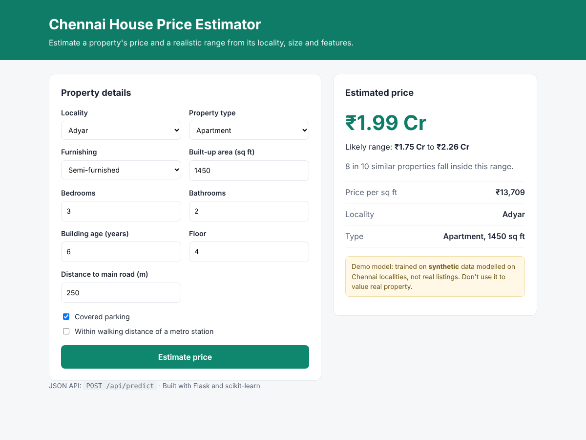
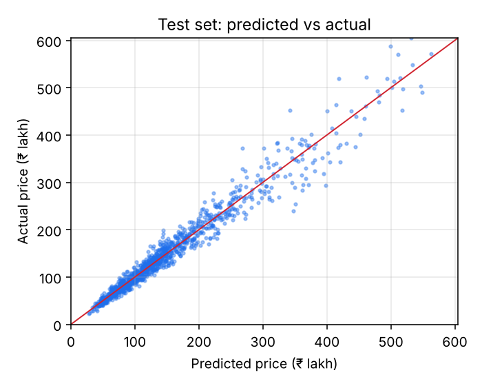

# Chennai House Price Estimator (Flask)

**A Flask web app and JSON API that estimates a Chennai property's price with a calibrated price range. It's built as a production-style ML service: a validated input schema, model selection with cross-validation, conformal prediction intervals, tests, Docker and CI.**


> **About the data:** this project uses a **synthetic dataset** generated by [`chennai_housing/simulate.py`](chennai_housing/simulate.py), because there's no open, downloadable Chennai listings dataset with a clear licence. The simulator encodes illustrative assumptions (locality price levels, premiums, depreciation, noise), so the model's accuracy shows that the pipeline works, **not** that it can value real homes. Swap in real listings with the same columns and retrain to use it for real.



## What it does

- **Web form:** enter locality, property type, area, rooms, age, floor, furnishing, parking, metro access and distance to the main road. You get a price in lakh or crore, a likely range, and the price per square foot.
- **JSON API:** the same model behind `POST /api/predict`, with field-level validation errors.
- **Calibrated range:** the 80% range really contains about 80% of prices (checked on the test set).

## How it's built

| Step | What I did and why |
| --- | --- |
| Data | Simulated 6,000 properties across 8 localities, from T Nagar and Adyar to Karapakkam ([data/README.md](data/README.md)) |
| Target | Modelled **log price**, because price errors scale with price |
| Model selection | 5-fold cross-validation comparing Ridge, Random Forest and HistGradientBoosting on MAPE |
| Uncertainty | **Split-conformal intervals**: the 10th and 90th percentiles of the model's cross-validated errors set the range around each estimate |
| Validation | One schema (`chennai_housing/schema.py`) shared by the form and the API, with clear messages per field |
| Serving | Flask app factory, Gunicorn in Docker, `/health` endpoint for monitoring |

## Results (held-out test set, 1,200 properties)

| Model | Cross-validated MAPE |
| --- | --- |
| Ridge (linear) | 10.6% |
| Random Forest | 9.2% |
| **HistGradientBoosting (selected)** | **7.9%** |

| Test metric | Result |
| --- | --- |
| MAPE | **7.9%** |
| MAE | ₹11.9 lakh |
| R² | 0.967 |
| 80% range coverage | **80.0%** |

The simulator adds about 9% random noise per property, so a MAPE around 7 to 8% means the model has learned nearly all the signal there is to learn. I first tried quantile regression for the range, but it only covered 66% of test prices. Conformal intervals fixed that.

<p align="center"></p>

## The API

```bash
curl -X POST http://127.0.0.1:5000/api/predict \
  -H "Content-Type: application/json" \
  -d '{"locality": "Adyar", "property_type": "Apartment", "furnishing": "Semi-furnished",
       "area_sqft": 1450, "bedrooms": 3, "bathrooms": 2, "age_years": 6, "floor": 4,
       "dist_main_road_m": 250, "parking": true, "near_metro": false}'
```

```json
{
  "formatted": "₹1.99 Cr",
  "price_inr": 19879000.0,
  "price_per_sqft": 13709,
  "range_inr": [17502000.0, 22569000.0]
}
```

Invalid input returns `400` with a message for each field:

```json
{"error": "Invalid input", "fields": {"furnishing": "Choose one of: Unfurnished, Semi-furnished, Furnished."}}
```

| Endpoint | What it does |
| --- | --- |
| `GET /` and `POST /` | Web form and result page |
| `POST /api/predict` | JSON prediction with range |
| `GET /api/options` | Valid localities, property types and furnishing options |
| `GET /health` | Status, model name and test MAPE |

## Run it

```bash
git clone https://github.com/Praveenasuku/Chennai-Housing-Price-Flask_App.git
cd Chennai-Housing-Price-Flask_App
python -m venv .venv && source .venv/bin/activate
pip install -r requirements.txt

flask --app app.app run --debug       # open http://127.0.0.1:5000
python -m pytest -q                   # 10 tests

# Optional: regenerate the data and retrain (about 25 seconds)
python -m chennai_housing.simulate
python -m chennai_housing.model
```

With Docker:

```bash
docker build -t chennai-house-price .
docker run -p 8000:8000 chennai-house-price   # open http://127.0.0.1:8000
```

## Project structure

```
chennai_housing/
  simulate.py   synthetic data generator (documented assumptions)
  schema.py     input validation and lakh/crore formatting
  model.py      model comparison, conformal range, training and prediction
app/
  app.py        Flask app factory: form, JSON API, health check
  templates/    result page
  static/       styles
models/         trained model and metrics.json
tests/          simulator, validation, API and form tests
```

## Next steps

- **Real data:** plug in actual listings (same columns) and compare against the synthetic baseline.
- **Explanations:** show the top factors behind each estimate with SHAP.
- **Deploy:** push the Docker image to a cloud service such as AWS App Runner, with the `/health` endpoint for monitoring.

---

**Praveena S**, Generative AI Engineer · [Portfolio](https://praveena-portfolio-two.vercel.app) · [LinkedIn](https://www.linkedin.com/in/praveena-suku/)
